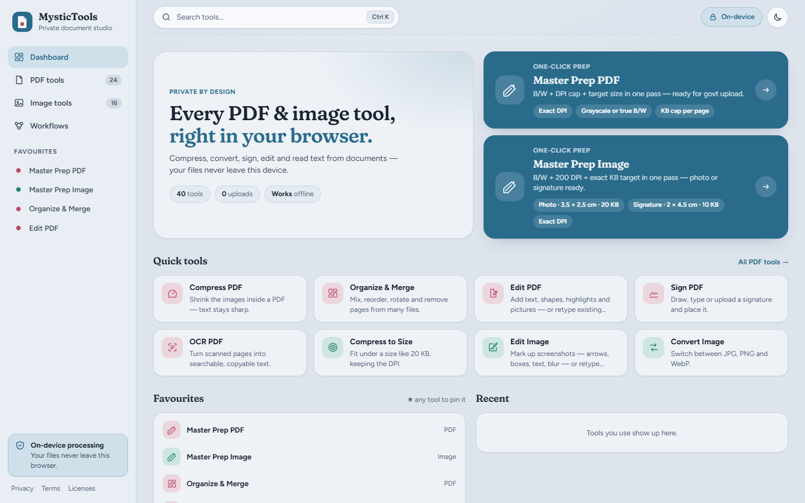
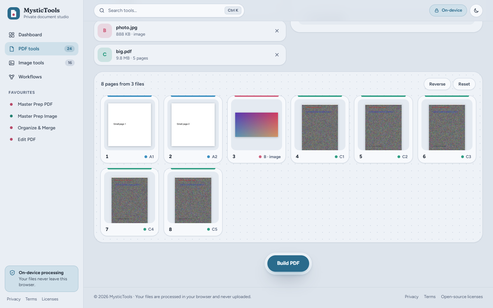
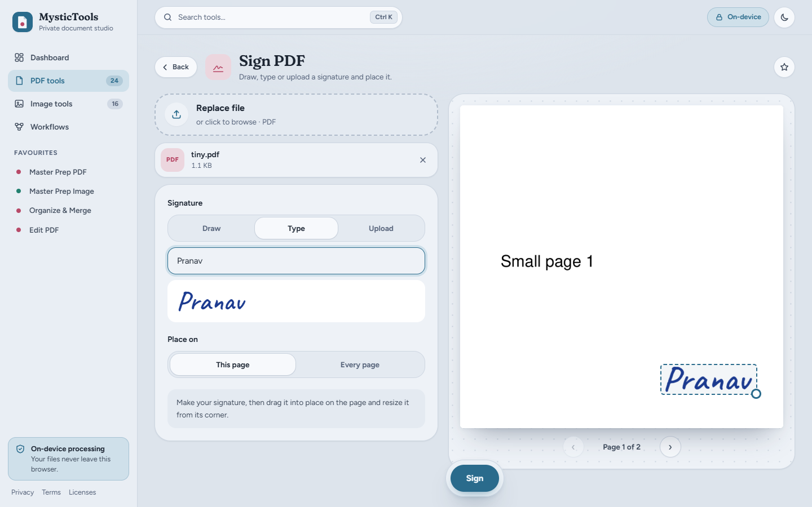

# MysticTools

**A private PDF & image studio — 40 tools that run entirely in your browser.**
Compress, merge, sign, edit, OCR and convert documents without uploading them anywhere.



Most online PDF tools upload your files to someone else's server. MysticTools doesn't:
every tool runs inside your browser tab (WebAssembly + Web Workers), and the site's
Content-Security-Policy blocks the page from sending data to any other origin. Open your
browser's Network tab while you use it — nothing leaves your device.

It started as a way to prepare documents for government portals (exact DPI, KB limits,
black & white) and grew into a full toolkit.

## Features

### PDF (24 tools)

| | |
|---|---|
| **Prepare & compress** | One-click *Master Prep* (grayscale/B&W + exact DPI + KB cap per page, batch), Compress, Compress to an exact size, Black & White, Repair |
| **Organize** | Organize & Merge (drag pages from several PDFs *and* images into one document, rotate, duplicate, delete), Split, Rotate, Crop |
| **Edit & sign** | **Edit PDF** — text, shapes, arrows, highlight, white-out, pictures, and *click any existing text to retype it in the document's own font*; Sign (draw, type or upload); Watermark; Page numbers; Flatten |
| **Convert** | OCR (make scans searchable — English & Hindi), PDF → Word, PDF → Text, PDF → images, Images → PDF, Extract images |
| **Security & privacy** | Protect (AES-256), Unlock, **Redact** (real removal, with one-click patterns for emails, phone, Aadhaar, PAN and card numbers), Metadata viewer/cleaner |

### Images (16 tools)

| | |
|---|---|
| **Compress & size** | *Master Prep* for photos & signatures (exact cm, DPI and KB), Compress, Compress to size, Resize, Size in cm |
| **Edit & enhance** | **Edit Image** — screenshot markup, blur, and OCR-based *click-to-retype* text with automatic font, size, weight and colour matching; Crop (incl. circle); Rotate/flip; Adjust & document clean-up; Watermark |
| **Convert** | JPG ↔ PNG ↔ WebP, **HEIC (iPhone) → JPG**, Black & white, Change DPI (lossless), Image → Text (OCR) |
| **Privacy** | Blur & Hide areas, Remove metadata (GPS/EXIF, lossless) |

### Workflows

Chain tools so one drop runs several steps — e.g. *resize to 3.5 × 2.5 cm → compress under 20 KB*.
Six presets are built in (application photo, signature, scan → portal PDF, phone photos → one PDF,
share a PDF safely, iPhone photos → JPG) and you can build and save your own.

<p>
  
  
</p>

Also: light & dark themes, command palette (<kbd>Ctrl</kbd>+<kbd>K</kbd>), favourites and recent
tools, installable as an app, and works offline after the first visit.

## How it works

| Piece | What it does |
|---|---|
| [MuPDF](https://mupdf.com) (WebAssembly) | Reads, renders, edits and writes PDFs inside a Web Worker |
| [Tesseract.js](https://github.com/naptha/tesseract.js) | OCR, loaded only when you first use an OCR feature |
| [libheif](https://github.com/strukturag/libheif) | Decodes iPhone HEIC photos, loaded only when needed |
| Canvas + small hand-written codecs | Image resizing, JPEG/PNG/WebP encoding, palette PNGs, lossless DPI and EXIF edits, ZIP |
| `static/_headers` | Strict CSP (`connect-src 'self'`), so the page cannot send your files anywhere |
| `static/sw.js` | Offline support for the app's own files — never your documents |

There is no backend and no build step: `static/` is the whole site. Every dependency is
vendored and self-hosted (including fonts), so the site makes no third-party requests at all.

## Run it locally

Requires [Node.js](https://nodejs.org) 18+.

```bash
npm install        # dev tools only (test runner, MuPDF package for vendoring)
npm start          # http://localhost:8765
```

On Windows you can also double-click `run.bat`.

## Tests

The suite drives the real app in headless Chrome or Edge and checks every tool's output
independently with MuPDF in Node:

```bash
npm test
```

## Deploy

The site is a static folder, so any static host works. With Cloudflare (free plan):

```bash
npx wrangler login
npm run deploy
```

If you use another host, serve the headers from `static/_headers` (the CSP is what
guarantees files can't leave the browser).

## Project structure

```
static/
  index.html, styles.css, app.js   UI shell, tools, router, dashboard
  editors.js, markup.js            Sign / crop / blur editors and the edit studio
  ocr.js, workflows.js             OCR and font matching; workflow builder and runner
  engine/                          Web Worker: PDF + image processing (MuPDF, codecs)
  vendor/                          MuPDF, Tesseract, libheif and fonts (self-hosted)
  privacy.html, terms.html, licenses.html
scripts/                           vendor.mjs (copy dependencies), serve.mjs, icons.mjs
tests/                             browser.test.mjs + sample files
```

After upgrading `mupdf`, `tesseract.js`, `libheif-js` or the fonts, run `npm run vendor`.

## License

MysticTools is free software under the **GNU Affero General Public License v3.0 or later** —
see [LICENSE](LICENSE). It uses MuPDF (AGPL-3.0), Tesseract.js (Apache-2.0), libheif (LGPL-3.0)
and the Figtree, Fraunces and Caveat typefaces (SIL OFL 1.1); details are on the
[open-source licenses page](static/licenses.html).

If you run a modified version on a public website, the AGPL requires you to offer your users
its complete source code.

---

Made by **MysticFox** · [contact@mysticfox.dev](mailto:contact@mysticfox.dev)
